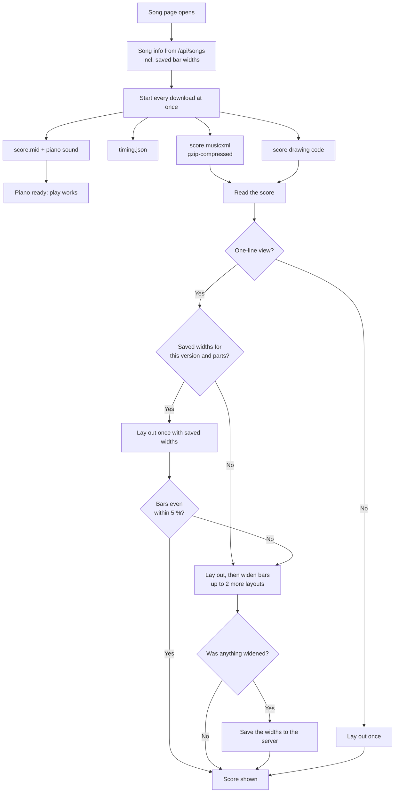

# Opening a song

How the song page loads a song and draws its score. Since #137 all downloads start together, the score file arrives compressed, and in the one-line view the score is laid out once with bar widths saved on the server, instead of up to three times.

## Colours
- **teal**: new or changed by #137
- **amber**: the slow path: a song version's first opening, or a saved set that came out uneven
- **green**: what the singer is waiting for

## Boxes
- **Song info from /api/songs incl. saved bar widths**: `song()` in `src/worker/index.ts` adds the row from the new `song_layouts` table for this song's version.
- **Start every download at once**: `onMounted` in `src/client/views/Player.vue`; today the piano starts only after the score file has arrived.
- **score.musicxml gzip-compressed**: `serveObject` in `src/worker/files.ts` marks whole MusicXML and JSON responses `Content-Encoding: gzip` and Cloudflare compresses them (8.2 MB → about 0.27 MB for Katedralen).
- **Lay out once with saved widths**: `Score.evenOut` in `src/client/player/score.ts` applies the saved `WidthFactor` per bar before the first layout.
- **Bars even within 5 %?**: `evenOut` in `src/client/player/score.ts` keeps a saved set whose biggest step between bars (`biggestStep`, `spacing.ts`) is at most 5 % over the cap; otherwise it widens as before, so a wrong or stale set only costs the old slow path.
- **Was anything widened?**: only a layout that had to widen calls `Score.onFactors`, so an even song saves nothing.
- **Save the widths to the server**: a new `PUT /api/songs/<choir>/<slug>/layout` in `src/worker/index.ts`, open to anyone who may open the song except on the open list (`public`); `parseLayout` in `src/worker/layouts.ts` checks the numbers. Stored in D1 `song_layouts` (`migrations/0010_song_layouts.sql`).
